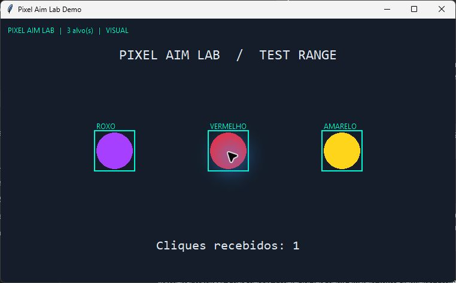

# BNQQ Aim

**Mira, trigger e overlay por cor no Windows.** O painel reúne controles independentes para mover a mira e disparar. Os três modos usam pixels visíveis e funcionam em um processo separado.



| Perfil | Alvo de exemplo | Detecção |
| --- | --- | --- |
| `amarelo` | `#FFD51C` | Amarelo saturado |
| `roxo` | `#A63FFF` | Violeta e roxo saturados |
| `vermelho` | `#F02B3E` | As duas pontas da escala de matiz |

## Trigger na área de trabalho

Com as dependências instaladas, abra **`Abrir-BNQQ-Aim.cmd`**. No painel, marque amarelo, roxo, vermelho ou uma combinação. Escolha a tecla de ativação, o botão do mouse, o atraso inicial e o intervalo. Clique em **Iniciar trigger**, segure a tecla e passe o cursor sobre a cor. A rajada para ao sair da cor ou soltar a tecla. Use `0` em Cliques para repetir continuamente. **F9** encerra o processo externo.

O padrão é amarelo, F8, botão esquerdo e três cliques. `Trigger-Amarelo.cmd` abre esse perfil sem o painel. O modo desktop atua no navegador e na área de trabalho, usando os pixels visíveis. Em jogos, depende do modo de exibição, de como o jogo controla o cursor e de aceitar cliques do Windows. Use em modos de treino que permitam automação. KovaaK’s e Aimlabs ainda não foram verificados.

```powershell
py -3 desktop.py --trigger --colors amarelo roxo vermelho --key F8 --button esquerdo --delay-ms 40 --interval-ms 180 --burst 3
```

Sem `--trigger`, o terminal apenas registra a cor encontrada. O modo área de trabalho usa `GetPixel` e roda como processo externo, separado dos aplicativos que você usa.

## Mira por cor e FOV

Marque **Habilitar mira por cor** no painel. Segure **F7** por padrão para mover o mouse em direção à região colorida mais próxima. O **raio FOV**, em pixels, limita a busca a um círculo centrado no cursor. A prévia no painel ilustra esse círculo. Aumentar a suavização reduz o movimento por etapa. A mira e o disparo têm teclas independentes. **F9** encerra os dois.

Para experimentar, abra `demo.py` e teste as cores sobre os círculos da janela. O algoritmo reconhece cores de pixels, inclusive elementos da interface com a mesma cor. O comportamento em jogos depende da captura, da posição do cursor e de como o aplicativo recebe movimento do mouse.

## Overlay com mira central

Use Python 3.10+ no Windows. Na pasta do projeto, instale as dependências e abra a demo:

```powershell
py -3 -m pip install -r requirements.txt
py -3 demo.py
```

Em outro terminal, inicie o overlay e volte à janela da demo:

```powershell
py -3 overlay.py --window "Pixel Aim Lab Demo" --colors amarelo roxo vermelho --trigger
```

- **F8 pressionado** habilita o clique enquanto uma região aceita estiver sob a mira central. Mantenha o cursor dentro da demo para ver o contador subir. Em jogos que usam a mira central, a entrada segue o comportamento do jogo.
- **F9** fecha o overlay. Sem `--trigger`, o programa só desenha e sinaliza quando o centro está sobre um alvo.
- `--min-area 100` descarta componentes menores. `--cooldown 250` aumenta o intervalo mínimo entre os cliques, em milissegundos.

## Compatibilidade

Para outra janela, passe o título exato em `--window` e comece no modo visual, com um único perfil. Use janela ou tela cheia sem bordas. O método depende das cores renderizadas e da captura do Windows. HUDs com a mesma cor podem gerar caixas falsas. Alvos escondidos ficam fora da detecção, e a automação pode ser ignorada por alguns aplicativos. Use o trigger em ambientes próprios ou de treino local autorizados.

## Como funciona

1. Pillow captura a área cliente da janela selecionada. O overlay some quando a janela perde o foco.
2. OpenCV converte o quadro em HSV, filtra por cor, remove pixels isolados e agrupa as regiões aceitas.
3. O indicador de mira usa pixels da região detectada perto do centro da janela. Uma caixa vazia no centro não aciona o clique.
4. O clique usa `SendInput` e exige `--trigger`, F8 pressionado e a janela selecionada em foco.

Execute `py -3 -m unittest -v` para testar as três cores, os dois intervalos do vermelho e a rejeição de ruído no centro.
